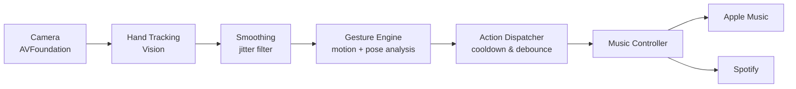

# airDJ

**Touch-free music control for iPhone, powered by on-device hand tracking.**

airDJ uses the iPhone's front camera and Apple's Vision framework to recognize hand gestures in real time and turn them into playback commands for Spotify and Apple Music. Prop up your phone while cooking, working out, or with your hands full, and skip tracks with a wave.


<!-- Add once CI is set up:  -->

<!-- Demo GIF goes here once the MVP is working -->
<!--  -->

---

## Gestures

| Gesture | Action |
|---|---|
| Swipe right | Next track |
| Swipe left | Previous track |
| Hold open palm (~1 s) | Play / pause |

Play/pause uses a short *hold* rather than an instant open-palm check. The hand is usually open during a swipe, so a hold keeps swipes from being mistaken for pause.

## Supported music apps

| App | Integration | Status |
|---|---|---|
| Apple Music | `MediaPlayer` (`MPMusicPlayerController.systemMusicPlayer`) | Planned |
| Spotify | Spotify iOS SDK (App Remote) | Planned |

---

## How it works



1. **Capture:** AVFoundation streams frames from the front camera, throttled to save battery.
2. **Hand tracking:** `VNDetectHumanHandPoseRequest` extracts 21 hand landmarks per frame.
3. **Smoothing:** a jitter filter stabilizes landmark positions between frames to reduce false triggers.
4. **Gesture recognition:** the gesture engine analyzes landmark motion over a sliding window to detect swipes and held poses.
5. **Dispatch:** recognized gestures pass through a cooldown and debounce layer to prevent repeated triggers.
6. **Playback control:** a common `MusicController` protocol sends the command to the active music service.

### Privacy

All processing happens on-device. Camera frames are never stored, recorded, or transmitted.

---

## Tech stack

| Area | Technology |
|---|---|
| Language & UI | Swift, SwiftUI, Observation (`@Observable`), Swift Concurrency |
| Camera | AVFoundation |
| Hand tracking | Vision |
| Music control | MediaPlayer (Apple Music), Spotify iOS SDK |
| Machine learning (stretch) | Create ML Hand Action Classifier, Core ML |
| Core logic | `AirDJCore`, a platform-independent Swift package (smoothing, gestures, dispatch) |
| Testing | XCTest / Swift Testing, recorded-landmark replay tests |
| Tooling | GitHub Actions CI, SwiftLint |

---

## Architecture

The project is split into two parts with clearly defined interfaces, so each piece can be built and tested on its own:

- **The iOS app** handles everything that needs Apple's frameworks: camera, Vision, music services, and UI.
- **`AirDJCore`** is a Swift package containing the core logic, with **no dependency on Apple frameworks**. It builds and tests on macOS, Linux, or Windows.

```
airDJ/                      iOS app (Xcode)
├── Camera/                 Frame capture and session management
├── HandTracking/           Vision hand-pose detection → HandFrame
├── Music/                  Apple Music / Spotify implementations of MusicController
└── UI/                     Now Playing, onboarding, settings, debug overlay

AirDJCore/                  Swift package (cross-platform)
├── Sources/
│   ├── Models/             Shared types: HandFrame, GestureEvent, MusicAction
│   ├── Smoothing/          Landmark jitter filtering
│   ├── Gestures/           Gesture recognition → GestureEvent
│   └── Dispatch/           Cooldown, debounce, gesture-to-action mapping
└── Tests/                  Unit tests and recorded landmark fixtures
```

Key interfaces:

- **`HandFrame`**: hand landmarks and confidence for a single frame
- **`GestureEvent`**: a recognized gesture (`.swipeLeft`, `.swipeRight`, `.palmHold`)
- **`MusicController`**: protocol for `play()`, `pause()`, `next()`, `previous()`

Gesture recognition is tested against **recorded landmark sequences** stored as JSON, so detection logic can be developed and regression-tested without a camera or a physical device.

---

## Roadmap

### Milestone 1: Foundation
- [ ] Xcode project, module structure, and core interfaces
- [ ] CI pipeline (build + test on every pull request)
- [ ] Live camera preview with hand-landmark debug overlay
- [ ] Spotify and Apple Music proof-of-concept connections

### Milestone 2: MVP
- [ ] Swipe left / right detection
- [ ] Open-palm hold detection
- [ ] Apple Music playback control
- [ ] Spotify playback control
- [ ] Now Playing screen

### Milestone 3: Polish
- [ ] Onboarding and permissions flow
- [ ] Settings (sensitivity, enabled gestures, preferred music app)
- [ ] Performance tuning (frame rate, battery, thermal)
- [ ] Accuracy benchmarks published in this README

### Stretch goals
- [ ] Custom gesture model trained with Create ML
- [ ] Thumbs-up to like/save a track
- [ ] TestFlight beta

Detailed task tracking lives on the [project board](../../projects) and in [Issues](../../issues).

---

## Metrics

We track the following to measure quality over time. Results will be published here as the project matures.

| Metric | Target | Current |
|---|---|---|
| Gesture recognition accuracy | ≥ 95% | n/a |
| False triggers per minute (idle) | < 0.1 | n/a |
| Gesture-to-action latency | < 300 ms | n/a |
| Processing frame rate | 15 fps | n/a |

---

## Known limitations

- **Foreground only.** iOS does not allow camera access in the background, so airDJ must stay open with the screen on.
- **Spotify Premium.** Full playback control through the Spotify SDK requires a Premium account and the Spotify app installed on the device.
- **Per-app integration.** iOS has no system-wide API for controlling another app's playback, so each music service needs its own integration.
- **Physical device required.** The iOS Simulator has no camera.

---

## Getting started

### Requirements

**iOS app**
- macOS with Xcode 15 or later
- iPhone running iOS 17 or later
- Spotify and/or Apple Music installed on the device

**`AirDJCore` only** (core logic and tests)
- [Swift toolchain](https://www.swift.org/install/) on macOS, Linux, or Windows
- Run tests with `swift test` from the `AirDJCore/` directory

### Setup
> Setup instructions will be added once the Xcode project is initialized.

---

## Contributing

We use a pull-request workflow: every change is made on a feature branch, reviewed by at least one teammate, and merged into `main` once CI passes. Design decisions are recorded in [`docs/decisions/`](docs/decisions/).

---

## Team

| Name | Role | Focus |
|---|---|---|
| [Name](https://github.com/username) | Tech Lead & Integrations | Architecture, Spotify & Apple Music, Now Playing UI |
| [Name](https://github.com/username) | App & Computer Vision | Camera pipeline, hand tracking, recording tools, app shell, onboarding & settings |
| [Name](https://github.com/username) | Gesture Detection | Swipe and palm-hold detection algorithms, sensitivity tuning |
| [Name](https://github.com/username) | Dispatch & Quality | Landmark smoothing, dispatch, test framework, accuracy benchmarks, CI |

See [Team Roles & Responsibilities](docs/ROLES.md) for a detailed breakdown of each role, how the pieces connect, and how we work together.

---

## License

<!-- Choose a license (e.g. MIT) and add a LICENSE file -->
TBD
